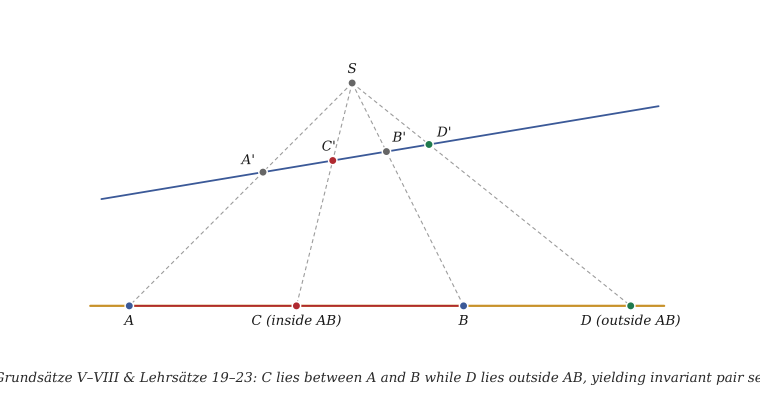

GEOMETOR • pasch
================

**Visit the Online Archive:** https://geometor.github.io/pasch/

**Moritz Pasch • Vorlesungen über neuere Geometrie • semantic digital archive**

Mission
-------

``geometor/pasch`` is part of the interconnected `GEOMETOR <https://geometor.com>`_ semantic digital archive. It preserves Moritz Pasch's groundbreaking 1882 treatise *Vorlesungen über neuere Geometrie*, which established the first fully rigorous modern axiomatization of projective and affine geometry through explicit axioms of order, planar separation (Pasch's Axiom), and segment incidence without relying on unstated visual intuition. Through addressable semantic units, calibrated theme-adaptive vector diagrams, primary-source folio provenance, and exact symbolic models, Pasch's axiomatic foundation speaks directly to the wider GEOMETOR corpus.

Books in This Archive
---------------------

- **`Lectures on Modern Geometry <https://geometor.github.io/pasch/vorlesungen_1882/>`_** — *Vorlesungen über neuere Geometrie* (Moritz Pasch, 1882) introducing the axiomatic foundation of order, planar separation, and projective coordinates.

Repository Contents
-------------------

- ``docsrc/`` — RST documentation source, book codex, and Sphinx docs compiled by `PHOTON publish <https://github.com/photon-platform/publish>`_.
- ``resources/`` — Primary-source folios, facsimile page images, and archival apparatus registries.
- ``src/geometor/pasch/`` — Exact SymPy symbolic implementations of ordered incidence, Pasch's axiom verification, and projective geometry.

Local Build & Verification
--------------------------

.. code-block:: bash

   publish build
   uv run --no-sync pytest

Part of the GEOMETOR Knowledge Archive
--------------------------------------

Explore all **74 Book Codices** and **11 Mathematical Catalogs** at https://geometor.com/books/.
