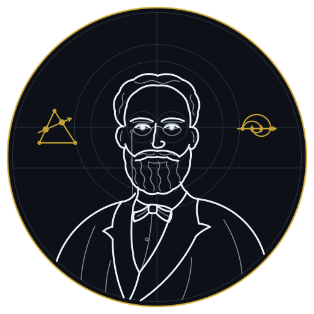

.. container:: author-overline

   semantic digital archive • the works of

============
Moritz Pasch
============

:person:`Moritz Pasch <pasch>` (1843–1930) laid the cornerstone of modern mathematical axiomatics in 1882—exposing the implicit topological assumptions hidden in Euclid and rebuilding linear order, planar triangle separation (*Pasch's Axiom*), and projective ideal sheaves strictly from explicit nuclear concepts (*Stammbegriffe*) and propositions (*Stammsätze*). This synchronized four-track German–English edition presents his *Vorlesungen über neuere Geometrie* alongside calibrated vector figures and exact symbolic models in ``geometor.pasch.order``.

Books in This Collection
------------------------

.. container:: home-book-hero

   .. container:: home-book-thumb

      .. image:: _static/figures/pasch_sec01_linear_betweenness_separation.svg
         :alt: Linear Betweenness and Segment Separation in Moritz Pasch's Vorlesungen (1882)
         :target: vorlesungen_1882/index.html

   .. container:: home-book-body

      .. rubric:: First Edition · 1882 (B. G. Teubner, Leipzig) · §§ 1–2 & §§ 8–12 · 4 Tracks

      **Lectures on Modern Geometry (Vorlesungen über neuere Geometrie)** — The complete four-track edition uniting the 1882 German text, original English translation, structural summaries, and critical notes: linear betweenness (*Zwischen*, § 1), Pasch's Planar Separation Axiom (*IV. Grundsatz*, § 2), ideal sheaves without infinity (§§ 8–11), and the hypothetico-deductive criterion (§ 12).

      .. container:: home-actions

         * :doc:`Open Lectures on Modern Geometry → <vorlesungen_1882/index>`
         * :doc:`§ 1: Linear Betweenness → <vorlesungen_1882/sec_01_betweenness/index>`
         * :doc:`§ 2 & §§ 8–12: Planar Separation → <vorlesungen_1882/sec_02_planar_separation/index>`

Key Features
------------

.. container:: home-feature-grid

   .. container:: home-feature-card

      **Four Synchronized Reading Tracks**

      Read the verbatim 1882 Leipzig German text alongside a faithful English translation, conceptual summaries, and critical mathematical-historical notes.

   .. container:: home-feature-card

      **Exact Symbolic Order & Pasch Verifier**

      Explore executable SymPy implementations of linear betweenness and Pasch's planar transversal axiom in :doc:`Demos <demos/index>` and ``geometor.pasch.order`` with zero floating-point approximations.

   .. container:: home-feature-card

      **Euclidean Gaps & Axiomatic Genealogy**

      Calibrated vector figures expose the implicit order gaps in Euclid I.16 and I.21, tracing Pasch's direct influence on Hilbert, Russell, Veblen, Tarski, and Hoenen.

Reference & Project
-------------------

.. container:: home-columns

   .. container:: home-col

      .. rubric:: Scholarly Apparatus

      * :doc:`People <people/index>` — 20 geometers, logicians, and philosophers from Euclid and Desargues to Hilbert and Tarski
      * :doc:`Bibliography <bibliography>` — Primary 1882 Teubner edition, classical antecedents, and critical studies
      * :doc:`Glossary <glossary>` — Bilingual German–English axiomatic lexicon (*Zwischen*, *Stammbegriffe*, *Stammsätze*)

   .. container:: home-col

      .. rubric:: About This Project

      * :doc:`About <about/index>` — Scope, textual witness, and Pasch's hypothetico-deductive revolution
      * :doc:`Using This Edition <usage/index>` & :doc:`Demos <demos/index>` — Navigation guide and symbolic verification scripts
      * :doc:`Log <log/index>` & :doc:`Modules <modules/index>` — Development notes and Python API documentation

.. toctree::
   :maxdepth: 2
   :hidden:

   vorlesungen_1882/index
   people/index
   bibliography
   glossary
   about/index
   usage/index
   demos/index
   log/index
   modules/index
